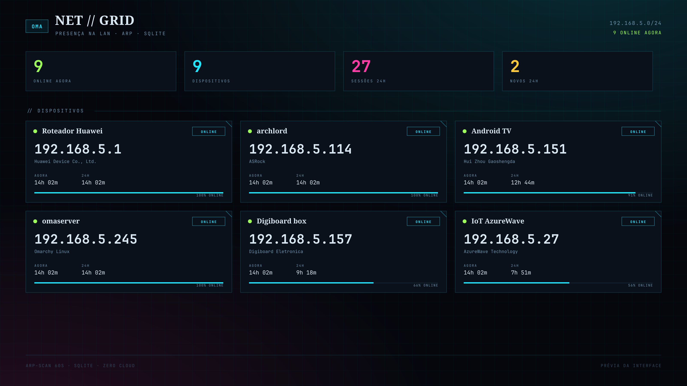
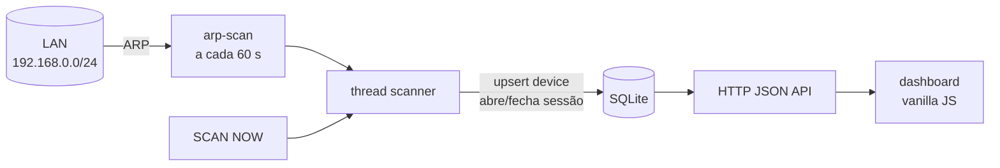

# OMA // NET

<p align="center">
  
</p>

<p align="center">
  <b>Presença na LAN com cara de terminal de cyberpunk.</b><br>
  Scan ARP a cada 60 s · histórico em SQLite · cards de dispositivos · gráfico de 24 h.
</p>

<p align="center">
  
  
  
  
  
</p>

Um serviço pequeno e teimoso: varre a rede local com `arp-scan`, guarda cada
entrada/saída em SQLite e serve um dashboard que mostra **quem está online,
há quanto tempo e quem é** — sem cloud, sem banco externo, sem framework.

Substituiu o NetAlertX no homelab: um container, um arquivo de banco, uma tela.

## O que tem

| | |
|---|---|
| **Dispositivos** | nome, IP, MAC, vendor, online/offline em tempo real |
| **Tempo conectado** | sessão atual (HH:MM:SS) + total das últimas 24 h |
| **Gráfico 24 h** | 96 buckets de 15 min por dispositivo; célula acesa = esteve online |
| **Quem é** | drawer com vendor, primeiro/último visto, histórico total e lista de sessões |
| **Apelidos** | renomeia na UI; o nome fica preso ao MAC e não é sobrescrito pelo scan |
| **Scan manual** | botão `SCAN NOW` (além do sweep automático de 60 s) |
| **Zero dependência de front** | HTML/CSS/JS puro, fontes locais, nenhuma CDN |

## Como funciona



- MAC visto no sweep → dispositivo `online`, sessão aberta se não havia uma.
- MAC ausente por **3 sweeps** (~3 min) → `offline`, sessão fechada.
- Reinício do container não perde nada: tudo em `./data/omanet.db`.
- O scan usa ARP (L2), então só enxerga a sub-rede do host. Para VLANs/redes
  remotas, rode uma instância por rede.

## Rodar

```bash
git clone https://github.com/Gedankenn/omanet.git
cd omanet
docker compose up -d --build
```

Por padrão o app escuta em `127.0.0.1:20211` (só esta máquina) e sem senha.
Abra `http://127.0.0.1:20211`.

Para ver de outro aparelho da LAN é obrigatório um token — sem ele o app
recusa subir fora do loopback:

```bash
export BIND=0.0.0.0
export OMANET_TOKEN="$(openssl rand -hex 16)"   # guarde no cofre
docker compose up -d --build
```

O navegador pede login (usuário livre, senha = token). O container usa
`network_mode: host` porque ARP precisa da interface real; isso expõe a porta
direto na LAN, então o token é a barreira.

## Segurança

- Sem `OMANET_TOKEN`, o app só escuta em loopback e se recusa a subir em
  `0.0.0.0`/IP de LAN.
- Autenticação: HTTP Basic em toda rota (inclusive estáticos e API); senha é
  o token, comparada com `hmac.compare_digest`.
- O banco guarda inventário de MAC/IP da rede: trate `data/omanet.db` como
  dado sensível e não commite.
- Não libere a porta no firewall além do necessário; prefira tailnet/VPN.

## Configuração

| Variável | Padrão | O que faz |
|---|---|---|
| `PORT` | `20211` | porta do dashboard e da API |
| `BIND` | `127.0.0.1` | endereço de escuta; fora do loopback exige `OMANET_TOKEN` |
| `OMANET_TOKEN` | vazio | senha do HTTP Basic; vazio = sem auth (só loopback) |
| `IFACE` | detecta via `ip route` | interface do scan (ex.: `enp6s0`, `eth0`) |
| `SCAN_INTERVAL` | `60` | segundos entre sweeps |
| `DB_PATH` | `/data/omanet.db` | caminho do SQLite dentro do container |
| `TZ` | `America/Sao_Paulo` | fuso dos horários |

Apelidos iniciais podem ser semeados em `names.json` (`MAC → nome`); a UI
também renomeia e grava `devNameSource = USER`.

## API

| Método | Rota | Retorno |
|---|---|---|
| `GET` | `/api/state` | stats + lista de dispositivos com timeline de 24 h |
| `GET` | `/api/device?mac=...` | detalhe + últimas 30 sessões |
| `POST` | `/api/name` | `{"mac":"...","name":"..."}` |
| `POST` | `/api/scan` | dispara um sweep imediato |
| `GET` | `/health` | `{"ok":true}` |

## Modelo de dados

```
devices(mac PK, name, vendor, first_seen, last_seen, last_ip, online, miss, name_source)
sessions(id PK, mac, ip, start_ts, end_ts NULL enquanto online)
meta(key, value)   -- último scan, contagem, erro
```

Timeline e totais são calculados na hora a partir das sessões; nenhum job de
agregação, nenhuma tabela de rollup.

## Estrutura

```
.
├── app.py                 # scanner + SQLite + HTTP (stdlib, ~330 linhas)
├── static/
│   ├── index.html         # dashboard (CSS/JS inline)
│   └── fonts/             # IBM Plex Sans + JetBrains Mono (OFL)
├── docker-compose.yml
├── Dockerfile             # alpine + python3 + arp-scan
├── names.json             # apelidos iniciais
└── tools/banner.py        # gera docs/banner.png
```

## Limites conhecidos

- **MAC randomizado**: celulares trocam de MAC e o apelido fica no MAC antigo.
  É o custo de identificar por L2; renomear de novo resolve.
- **Sem autenticação**: pensado para LAN confiável. Se expor, ponha atrás de
  um reverse proxy com auth.
- **Só L2**: não atravessa VLAN, Wi-Fi de convidados ou sub-redes roteadas.
- **Host network**: necessário para ARP; a porta não é remapeada pelo Docker.

## Licença

Código: sem licença definida (fale com o autor antes de reutilizar).
Fontes em `static/fonts/`: SIL Open Font License 1.1 — texto completo em
[`static/fonts/OFL.txt`](static/fonts/OFL.txt).
